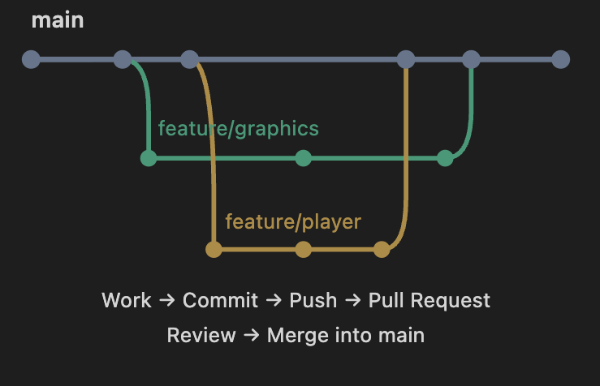

# Team Git Workflow

We will be using GitHub to manage our code and coordinate work among team members. So this document will serve as a guide for our workflow and best practices. 

## Repository Structure

```text
├── README.md
├── src/
│   ├── main.asm
│   ├── graphics.asm
│   ├── player.asm
│   ├── obstacles.asm
│   └── collision.asm
├── docs/
│   └── team_git_workflow.md
└── .gitignore
```

## Branching Strategy



We will use a main branch for stable code and feature branches for new work. Each feature branch will be merged into main after review.

**Branches**

- `main` branch: Will hold the latest working version of the game. We should not push changes directly to it.
- `feature/*` branches: These will be used for new features and changes. 

Before we merge changes into main, we must create a pull request and have it reviewed by another team member and verify the code works. 

## Daily Workflow

1. Switch to `main` branch and pull the latest changes. 

    ```bash
    git switch main
    git pull origin main
    ```
2. Switch to your feature branch.

    ```bash
    git switch feature/my-feature
    ```
    Work on your feature in this branch
3. Commit your changes.

    ```bash
    # check what changed
    git status 
    
    # You can use but this adds all changes in one go
    git add . 

    # Or add specific files instead 
    git add <file>  

    # Then commit your changes. It must include a message
    git commit -m "Your message here"
    
    ```
4. Push your changes to the remote feature branch.

    ```bash
    # Final step is to push to remote branch
    git push origin feature/my-feature
    ```

When you are done with your feature branch, create a pull request to merge into main. Make sure another team member reviews it first.

After merging, delete the feature branch to keep things clean.

```bash
    git branch -d feature/my-feature
```

## Git Command Cheat Sheet

### First-time Setup
After installing Git, set your name and email.
```bash
git config --global user.name "Your Name"
git config --global user.email "you@example.com"
```

Next clone the repository
```bash
git clone <repo-url>
```
You will be may be asked to sign in github when cloning. Just follow the prompts. The password is your section will not show you the entered text. Also, Git no longer supports password authentication for HTTPS, so you may need to generate a Personal Access Token. You can generate it in your GitHub settings. Scroll down to Developer settings, and create a token. Once done, copy it and use it as your password. Note, that you will not see that token again once created so make sure you save it somewhere safe. 

By default, the terminal will not show you what branch you are on. Use `git branch` to see it. What I did was install  Oh My Zsh which shows the branch in the prompt.

### Everyday Commands

|Command | Purpose |
|-------|---------|
|git status | Check changes and branch |
|git branch | See current branch |
|git switch main | Switch to main |
|git pull origin main | Get latest main changes |
|git switch -c feature/my-feature | Create and switch to feature |
|git add src/player | Stage changes in player file |
|git commit -m "Add jump feature" | Commit changes with message |
|git push -u origin feature/player | Publish a new branch to GitHub |
|git push origin feature/player | Push changes to remote branch |
|git branch -d feature/player | Delete local branch |
|git log --oneline -5 | See last 5 commits |
|git diff | Review changes that are not staged |


### Example:
Say you wanted to implement a jump feature to the player module. 

**Step 1:** Create a feature branch.

```bash
# Go the main branch in your local repo first
git switch main 
# Update main first
git pull origin main
# Create feature branch next and switch to it
git switch -c feature/player-jump
```

**Step 2:** Make your changes and test it.

Edit player.asm and test it in MARS. Once your changes work, save them. 

**Step 3:** Stage and commit your changes.
Check the status, see what changed, and ensure that you are in the right branch, then stage and commit.
```bash
git status
# Stage the file next that was modified
git add player.asm
# Commit the changes next
git commit -m "Add jump feature"
```

**Step 4:** Push your branch to GitHub.

```bash
# Push the branch to GitHub
git push -u origin feature/player-jump
```

**Step 5:** Create a pull request on GitHub.
On GitHub, go to the repository and you should see a

**Note:** Since we only have one main branch, always base your features off of the main branch. Meaning start from main each time before creating a new feature branch.

## Handling Common Problems

|Situation | Recommended action |
|---------|--------------------|
|Forgot which branch you are on | Use `git branch` |
|Made changes but haven't committed | Use `git status` to check |
|Want to inspect changes | Use `git diff` |
|Stage the wrong file | Use `git restore --staged filename` |
|Need to discard any uncommited changes | Use `git restore filename` But be careful, it will erase changes |
|Git reports a merge conflict | Stop, inspect conflicting files, and ask another team member for help |
|Your push is rejected | Check wheher the remote branch has new changes before attempting to push |
|Accidentally committed to main | Use `git revert` to undo the commit |


Try to avoid the following: 
1. `git push --force` unless necessary. This can overwrite others' work.
2. `git reset --hard` This will erase local changes, use with caution.
3. Forgetting to pull before pushing can cause issues.
4. `git rebase` can rewrite history. Especially if others have based work on the branch. 

## GuideLine
- [ ] Never push directly to main
- [ ] Always run git status before committing
- [ ] Pull before pushing
- [ ] Use feature branches
- [ ] Test your code in MARS before opening a Pull Request
- [ ] Use decriptive commit messages, but keep them under 72 chars. The rule is 50/72.
- [ ] Have another team member review your Pull Request
- [ ] Communicate with team members about changes
- [ ] Avoid force pushing
- [ ] Notify team when Git reports conflicts